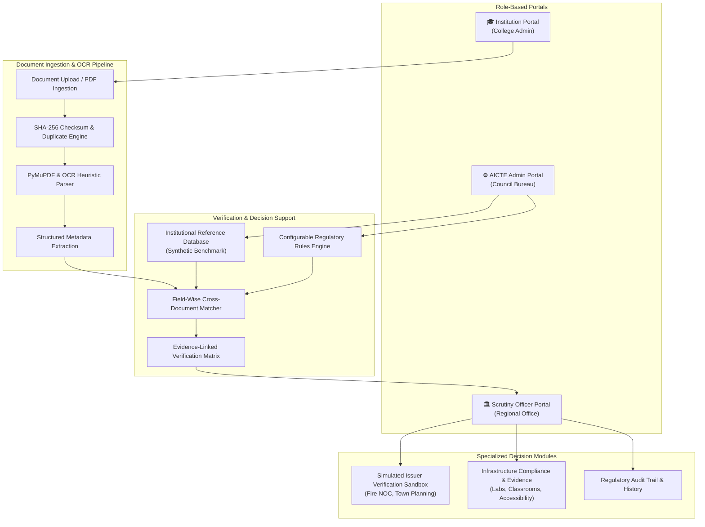

# AI-Powered Application Validation, Document Authentication & Regulatory Compliance Verification

**Smart India Hackathon (SIH) Problem Statement ID:** `SIH26261`  
**Organization:** All India Council for Technical Education (AICTE), Ministry of Education, Government of India  
**Theme:** Smart Education / Governance & Administrative Reforms  
**Prototype Release:** v1.0.0-PROTOTYPE  

---

> [!IMPORTANT]
> **Regulatory Decision-Support Disclaimer:**  
> This software is an **AI-assisted regulatory decision-support platform**. Automated checks, extraction scores, and preliminary verification statuses assist authorized officials. Final regulatory approvals, statutory scrutiny, and physical campus inspections remain strictly with competent AICTE statutory authorities.

> [!NOTE]
> **Synthetic Demonstration Data Notice:**  
> In accordance with SIH development guidelines, all institutional names (e.g., *ABC Institute of Technology, Pune*), Permanent IDs (`1-1234567890`), Application IDs (`APP-DEMO-001`), course quotas, and external issuing authority records are **synthetic data** designed for demonstration and technical evaluation. No restricted government databases or confidential records are accessed.

---

## 1. Executive Summary & Problem Context

AICTE processes thousands of institutional applications annually for **Extension of Approval (EoA)**, introduction of emerging courses (such as AI & Data Science), and changes in student intake. Manual scrutiny across varied document formats is prone to:
1. **High volume and manual scrutiny delays.**
2. **Discrepancies in course intake vs. sanctioned council quotas.**
3. **Missing mandatory identifiers and unverified signature blocks.**
4. **Altered, duplicate, or expired statutory certificates (Fire NOC, Building Completion).**
5. **Lack of immediate evidence traceability between findings and original documents.**

### The Solution: SIH26261 Decision Support System
A unified, web-based, role-governed platform connecting **Institutions**, **AICTE Scrutiny Officers**, and **System Administrators**:
- **Automated Ingestion & Hybrid OCR:** Extracts key metadata (Permanent ID, Application ID, Academic Session, Course & Intake schedules) with PyMuPDF and OCR heuristics.
- **Evidence-Linked Regulatory Verification:** Generates transparent, traceable finding cards linking extracted values, expected values, document names, and page coordinates with explicit recommended actions.
- **Cryptographic Integrity & Anomaly Checks:** SHA-256 checksum hashing detects inter-institution document reuse and tampering.
- **Simulated Third-Party Issuing Authority Sandbox:** Illustrates electronic handshake with statutory authorities (Fire Directorate, Municipal Town Planning) with an explicit prototype simulation badge.
- **Infrastructure Compliance Evidence Review:** Facilitates structured evaluation of laboratory specifications, smart classrooms, libraries, and barrier-free accessibility with referral to Expert Visiting Committees (EVC) for physical inspection.

---

## 2. System Architecture



---

## 3. Three Connected Role-Based Interfaces

### Interface 1: Institution / College Portal (ABC Institute of Technology)
- **5-Step Application Wizard:** Step 1: Details → Step 2: Uploads → Step 3: AI Check → Step 4: Findings → Step 5: Status.
- **Document Checklist:** EoA schedule, Fire Safety NOC, Building Completion certificate.
- **Preliminary Status Tracker:** Real-time visibility into automated findings, compliance scores, and reviewer clarification requests.
- **Resubmission Workflow:** Correct and re-upload documents flagged for discrepancies.

### Interface 2: AICTE Scrutiny Officer / Reviewer Workspace
- **Scrutiny Queue:** Priority filtering by urgency, intake discrepancies, and missing certificates.
- **Split-Screen Verification Workspace:**
  - *Left Pane:* Interactive document viewer (PDF rendering, checksum inspection, tamper alerts).
  - *Right Pane:* AI-extracted metadata side-by-side with authorized council reference values and rule verdicts.
- **Reviewer Action Modal:** Record regulatory observations, request institutional clarification, refer for physical inspection, or escalate to Standing Hearing Committees (SHC).
- **Audit Trail:** Immutable, timestamped history of all officer interventions.

### Interface 3: AICTE System Administrator Portal
- **Category Manager:** Extension of Approval (EoA - Primary Demo), Grant of New Institution, Increase in Intake.
- **Metadata Schema Manager:** Configure regex extraction rules, mandatory vs. optional tags, and data types.
- **Regulatory Rules Engine:** Enable/disable rule checks (Intake quotas, Permanent ID match, Signature completeness).
- **Institutional Reference DB:** Configure and update benchmark institutional records.

---

## 4. Primary Demonstration Scenarios

The prototype includes three pre-compiled synthetic test documents and a top **Judges Quick-Test Banner** for instant 1-click evaluation:

| Test Case | Document Name | Characteristic / Injected Issue | Expected System Verdict |
|---|---|---|---|
| **Scenario A** | `Doc_A_Correct_EoA.pdf` | All fields present; Permanent ID `1-1234567890`; Comp Engg: 120; AI&DS: 60 | **Preliminary Checks Completed (96.5% Score)**. All checks matched. |
| **Scenario B** | `Doc_B_Incorrect_EoA.pdf` | Comp Engg intake is **180** (sanctioned: 120); AI&DS course omitted | **Correction Required (42% Score)**. Critical intake mismatch flagged. |
| **Scenario C** | `Doc_C_Incomplete_EoA.pdf` | Permanent ID missing; Course table blank; Signatures omitted | **Under Scrutiny / Manual Review (25% Score)**. Missing mandatory identifiers. |

---

## 5. Official SIH26261 Requirement Alignment Table

| Official AICTE Problem Requirement | Prototype Implementation Feature | Implementation Status | Evidence in Prototype |
|---|---|---|---|
| **Application Validation** | 5-step EoA submission workflow & checklist validation | **Implemented** | Institution Portal & Application Details |
| **OCR & Document Extraction** | PyMuPDF text & heuristic regex metadata parser | **Implemented** | OCR extraction panel & confidence scores |
| **Missing Information Detection** | Statutory field omissions (Permanent ID, AY, signature) | **Implemented** | Critical finding cards & alerts |
| **Institutional Record Matching** | Cross-checking against synthetic institutional reference DB | **Implemented** | Split-screen workspace comparison |
| **Document Anomaly & Alteration** | SHA-256 duplicate detection & layout inspection | **Implemented** | Checksum verification bar & anomaly tags |
| **Original Issuer Verification** | Mock third-party issuing authority query sandbox | **Simulated for Demo** | `CERT-DEMO-101` sandbox query with warning badge |
| **Configurable Regulatory Rules** | Admin rule manager with toggleable compliance rules | **Implemented** | Admin Rules Configuration view |
| **Infrastructure Compliance** | Laboratory, classroom, library & ramp evidence review | **Prototype / Partial** | Infrastructure Review page with EVC referral |
| **Evidence-Linked Findings** | Traceable findings cards with document name & page ref | **Implemented** | Verification Report Modal & Print Matrix |
| **Deficiency & Scrutiny Alerts** | Real-time status banners and priority queue badges | **Implemented** | Dashboard notification cards & badges |
| **Regulatory Audit History** | Timestamped ledger of officer actions & remarks | **Implemented** | Regulatory Audit Trail page |
| **Human Regulatory Oversight** | Officer decision-support actions (Clarification / Inspection) | **Implemented** | Officer Action recording modal |

---

## 6. Technology Stack

- **Backend:** Python 3.13, FastAPI, Uvicorn, Pydantic v2
- **Document Processing & OCR:** PyMuPDF (`fitz`), ReportLab (synthetic PDF generation), SHA-256 cryptographic hashing
- **Frontend:** Single Page Application (SPA) served via FastAPI StaticFiles + React 18, TypeScript, Tailwind CSS, Lucide Icons
- **Security & Safeguards:** Input validation, strict role isolation, CORS controls, sanitized file handling

---

## 7. Quick Start Guide (Run in 1 Command)

### Prerequisites
- Python 3.10+ installed on your system.

### Step 1: Install Python Dependencies
```bash
pip install -r backend/requirements.txt
```

### Step 2: (Optional) Re-generate Sample PDFs
The synthetic test documents are already generated, but can be regenerated at any time:
```bash
python backend/sample_docs/generate_sample_docs.py
```

### Step 3: Launch the Prototype
```bash
python backend/run.py
```

### Step 4: Access the Application
Open your web browser and navigate to:
- **Interactive Web Application:** [http://127.0.0.1:8000](http://127.0.0.1:8000)
- **Interactive Swagger API Docs:** [http://127.0.0.1:8000/docs](http://127.0.0.1:8000/docs)
- **API Health Endpoint:** [http://127.0.0.1:8000/api/health](http://127.0.0.1:8000/api/health)

---

## 8. Safe Demo Personas & Credentials

| Role | Username / Identifier | Password | Access Scope |
|---|---|---|---|
| **College Principal / Admin** | `principal@abctech.edu.in` | `abc123` | Application submission, document uploads, status tracking |
| **AICTE Scrutiny Officer** | `officer.rksharma@aicte-india.org` | `officer123` | Split-screen scrutiny, findings review, EVC referral, audit trail |
| **AICTE Bureau Admin** | `admin@aicte-india.org` | `admin123` | Rule configuration, template metadata schemas, reference DB |

*(Note: In the prototype web interface, roles can also be switched instantly via the top-right role selector for ease of presentation.)*

---

## 9. Recommended Video Demonstration & Presentation Sequence

1. **Problem Introduction (30s):** Highlight AICTE's challenge in processing thousands of applications and the risk of unverified course expansions or altered documents.
2. **Institution Portal & Submission (60s):**
   - Log in as ABC Institute of Technology.
   - Show the 5-step EoA application wizard and document checklist.
   - Click **"Test Doc A: Correct EoA"** to demonstrate automated OCR extraction and clean verification.
3. **Discrepancy Detection (60s):**
   - Click **"Test Doc B: Intake Mismatch"**.
   - Show how the AI engine immediately flags the 180 vs. 120 intake discrepancy and missing AI&DS course.
4. **AICTE Officer Scrutiny Workspace (90s):**
   - Switch to **AICTE Scrutiny Officer Portal**.
   - Demonstrate the **Split-Screen Workspace**: original document preview on the left, evidence-linked findings on the right.
   - Demonstrate the **Simulated Issuer Verification Sandbox** using `CERT-DEMO-101` and `CERT-DEMO-EXPIRED`.
   - Review **Infrastructure Compliance** and refer ramp accessibility for physical EVC inspection.
   - Record an official **Correction Request** action and show the updated **Audit Trail**.
5. **AICTE Admin Configuration & Future Roadmap (30s):**
   - Show configurable regulatory rules and reference records.
   - Conclude with the future API integration roadmap (DigiLocker, State Fire Portals).

---

## 10. Known Prototype Limitations & Future Production Roadmap

- **Simulated Third-Party Handshake:** The issuer verification module is currently a high-fidelity demonstration sandbox. Production deployment will require formal API MoUs with State Fire Directorates, Municipal Corporations, and DigiLocker.
- **Physical Infrastructure Verification:** Photo uploads provide preliminary assistance only; physical campus inspection by AICTE Expert Visiting Committees (EVC) remains mandatory for final approvals.
- **Advanced Computer Vision:** Future versions will integrate computer vision models for classroom carpet area estimation and laboratory equipment counts from geotagged 360° photographs.
